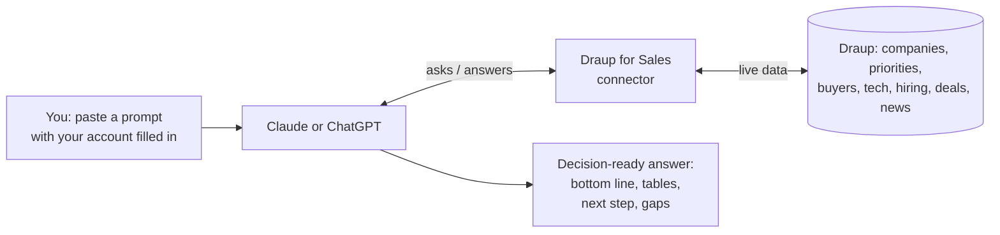

    

<b>Ready-to-use prompts for Claude and ChatGPT that turn Draup's sales intelligence into account briefs, buyer maps, target lists and outreach.</b>

<a href="https://claude.ai/directory/draup-for-sales"><b>Add to Claude</b></a> · <a href="https://chatgpt.com/plugins/plugin_asdk_app_6ad0b735a0d88191b98c333a6fe40ce7"><b>Add to ChatGPT</b></a> · <a href="guides/connect.md#option-3-any-mcp-client-custom-connector">Other MCP clients</a> · <a href="https://draup.github.io/draup-sales-prompts/">Interactive library</a> · <a href="#download-the-guides">PDF guides</a>

## Start in 3 steps

**1. Connect Draup to your AI.** About two minutes. You need a Draup account with Draup for Sales access.

| You use | Do this |
|---|---|
| **Claude** | [Add Draup for Sales from Claude's directory](https://claude.ai/directory/draup-for-sales), click **Connect** and sign in with your Draup account. |
| **ChatGPT** | [Add the Draup for Sales plugin](https://chatgpt.com/plugins/plugin_asdk_app_6ad0b735a0d88191b98c333a6fe40ce7) and sign in with your Draup account. |
| **Claude Code, Cursor, VS Code or your own agent** | Add Draup as a custom MCP connector: [step-by-step setup](guides/connect.md#option-3-any-mcp-client-custom-connector). |

**2. Tell your assistant about you, once.** Paste [Tell your AI about you](prompts/00-start-here/about-me.md) at the top of a new chat with your role, offering, territory and competitors. In Claude you can save it in a Project so it's always on.

**3. Pick a prompt, fill the `[brackets]`, paste.** Every prompt has a detailed version for the best results, a quick version, and follow-ups to keep going.

> Every answer opens with a two-line **bottom line** and closes with a **recommended next step** (who to contact, what to do, why now) and the **gaps** worth asking about in discovery.

## How it works

## What you can do with it

| Job | What you get |
|---|---|
| **Walk into every meeting prepared** | A one-page brief on any account in two minutes: size, money, priorities and recent moves. |
| **Find the right people** | The buying committee, new leaders, and warm paths in through your existing customers. |
| **Reach out at the right moment** | Hiring spikes, leadership changes, new tools and news, the week they happen. |
| **Build better target lists** | Lists sized to your ICP, accounts using a competitor, companies hiring for what you sell. |
| **Win services deals** | The incumbent providers, how deep they go, and where the wedge is. |
| **Plan and grow accounts** | Account plans, risk checks, QBR prep and territory tiers backed by data. |

## Start with these

| Prompt | What you get | Time |
|---|---|---|
| [10-minute pre-call snapshot](prompts/01-account-research/precall-snapshot.md) | Five short bullets you can read in the lobby: who they are, what just happened, where hiring is rising, the priority closest to your offer, and one question to ask. | 1–2 min |
| [One-page account brief](prompts/01-account-research/account-brief.md) | A one-page brief on size, money, priorities, recent deals and any competitor in the stack, ending with who to call and why now. | 2–4 min |
| [Map the buying committee](prompts/02-buyers-and-stakeholders/buying-committee.md) | A ranked list of the people likely to buy, influence or block your deal in one function or workload, with their role in the decision, an entry point and the sponsor to reach later. | 2–4 min |
| [What's worth acting on now](prompts/04-signals-and-timing/whats-actionable.md) | Up to 5 real triggers from the last 90 days, each tied to a stated priority, a likely owner and a suggested action, with the noise stripped out. | 2–4 min |
| [Signal-to-email (one or a few accounts)](prompts/04-signals-and-timing/signal-to-email.md) | For one account or up to 5 per pass: the freshest relevant signal, the priority it supports, and a short, sourced opener for your persona that ends in one low-friction ask. | 4–6 min |
| [Hypothesis-led discovery questions](prompts/02-buyers-and-stakeholders/discovery-questions.md) | An opening insight and eight discovery questions, each built on a dated fact about the account, with the hypothesis behind it and what a good answer tells you. | 2–4 min |
| [Is a competitor installed?](prompts/03-tech-stack-and-displacement/competitor-installed.md) | A clear verdict on whether a rival's products are live anywhere in the account's stack, how central they are, who else is in the room and which stated priorities could justify a switch. | 2–4 min |
| [Build and size an ICP list](prompts/05-prospecting-and-lists/icp-list.md) | The true size of your ideal-customer list, size bands, and the top 25 accounts with money, providers, hiring, who to call and a why-now for the best 5. | 4–6 min |
| [Is this inbound account worth it?](prompts/05-prospecting-and-lists/inbound-qualification.md) | A fast pursue / nurture / disqualify verdict on an inbound or referred account, based on your must-haves, with urgency from recent events, a read on the requester and a reply plan. | 1–2 min |
| [Draft an account plan](prompts/08-account-planning-and-expansion/account-plan.md) | An account plan in eight parts: snapshot, their strategy in their own words, buying committee, incumbents, ranked expansion plays, risks and a 90-day plan, plus an optional short SWOT. | 6–10 min |
| [Outsourcing footprint and incumbents](prompts/06-outsourcing-and-services/outsourcing-footprint.md) | How much the account outsources, to whom, how concentrated its provider base is, and which workloads are ripe for vendor consolidation. | 2–4 min |
| [Weekly trigger sweep for my book](prompts/04-signals-and-timing/weekly-book-sweep.md) | One table of the week's real triggers across up to 10 accounts, each with a so-what and an action, plus a clean list of accounts with nothing new. | 4–6 min |

## Find prompts by role

| Your role | What the prompts help you do |
|---|---|
| [**Account Executive**](roles/account-executive.md) | Win new logos: research, buyers, timing and a sharp first meeting. |
| [**SDR / BDR**](roles/sdr-bdr.md) | Find who to contact and why now, then write outreach that references real facts. |
| [**Account & Customer Success Manager**](roles/account-manager.md) | Grow and protect existing accounts: risk checks, expansion, QBRs. |
| [**Sales Leader & RevOps**](roles/sales-leader-revops.md) | Size markets, tier accounts, carve territories and focus the team. |
| [**Marketing & ABM**](roles/marketing-abm.md) | Pick target accounts and write messages tied to what each account is doing. |
| [**Presales & Solutions**](roles/presales-solutions.md) | Understand architecture, priorities and incumbents before the technical conversation. |
| [**Services, SI & Staffing Seller**](roles/services-seller.md) | Map outsourcing incumbents, share of wallet, GCCs and displacement wedges. |
| [**Partnerships & Alliances**](roles/partnerships-alliances.md) | Find co-sell partners already embedded in your target accounts. |

## Find prompts by sales job

| Sales job | What it covers | Prompts |
|---|---|---|
| [**Start here**](prompts/00-start-here/README.md) | Tell Claude who you are and what you sell, once. Every other prompt gets sharper. | 2 |
| [**Account research**](prompts/01-account-research/README.md) | Know the account before you call: size, money, priorities, filings and earnings calls. | 12 |
| [**Buyers and stakeholders**](prompts/02-buyers-and-stakeholders/README.md) | Find the people who own the problem and the budget, and a warm way in. | 7 |
| [**Tech stack and displacement**](prompts/03-tech-stack-and-displacement/README.md) | See what they run, what's new, what's fading, and where a competitor is installed. | 7 |
| [**Signals and timing**](prompts/04-signals-and-timing/README.md) | Reach out when something just changed: hiring spikes, leadership moves, news, new tools. | 11 |
| [**Prospecting and target lists**](prompts/05-prospecting-and-lists/README.md) | Build, size and qualify target lists from firmographics, tech, hiring and growth. | 10 |
| [**Outsourcing and services deals**](prompts/06-outsourcing-and-services/README.md) | For IT services, consulting and staffing sellers: incumbents, share of wallet, GCCs and wedges. | 11 |
| [**Industry and market intelligence**](prompts/07-vertical-intelligence/README.md) | Industry-level numbers, priorities and vendor landscapes for pitches and planning. | 7 |
| [**Account planning and expansion**](prompts/08-account-planning-and-expansion/README.md) | Account plans, entry points, risk checks, QBR prep and territory tiering. | 11 |
| [**Content and enablement**](prompts/09-content-and-enablement/README.md) | Turn Draup data into battlecards, ABM messages and email sequences. | 5 |
| [**Talent cost and location**](prompts/10-talent-cost-and-location/README.md) | Cost-arbitrage, location and hiring-difficulty cases for services pursuits. Uses the Draup for Talent connector. | 7 |

## Playbooks: complete workflows

Each playbook chains prompts into one end-to-end job. Run the steps in one chat.

| Playbook | Goal | Time |
|---|---|---|
| [**First meeting in 30 minutes**](playbooks/playbook-first-meeting.md) | Walk into a first meeting knowing the account, the people in the room and the questions that will earn a second meeting. | 25–35 min |
| [**Win accounts from a services competitor**](playbooks/playbook-displacement-campaign.md) | Find accounts where a rival services firm is the incumbent, pick the ones where it's weakest, and open with peer proof and a timely, evidence-based message. | 45–60 min |
| [**Weekly signal routine**](playbooks/playbook-weekly-signals.md) | Spend about half an hour each Monday finding which accounts and industry moves deserve action this week, and send the first touches. | 20–30 min weekly |
| [**Existing customer: account plan → risk → QBR**](playbooks/playbook-account-plan-qbr.md) | Build or refresh the plan for a key customer, turn it into concrete expansion plays, check it for risk, and walk into the QBR with a point of view and clear asks. | 45–60 min |
| [**Global capability centre (GCC) & outsourcing pursuit**](playbooks/playbook-gcc-services-pursuit.md) | Size an account's outsourcing and captive-centre (GCC) footprint, read its sourcing intent, check the main incumbent, and build a pursuit brief for the executive sponsor. | 55–70 min |
| [**Partner co-sell**](playbooks/playbook-partner-cosell.md) | Find where partners are already embedded at a target account, pick the right one to co-sell with, and open jointly. | 35–45 min |
| [**Territory and list building**](playbooks/playbook-territory-list.md) | Turn an ICP into a sized, prioritised and tiered account list your team can work this quarter. | 40–50 min |
| [**Enter a new industry**](playbooks/playbook-new-industry.md) | Learn a new industry fast, see who wins there, build a first account list, and launch outbound with a point of view. | 45–60 min |
| [**Expand an existing customer**](playbooks/playbook-expand-customer.md) | Find where an existing customer is growing, pick the best way in for your next deal, map the people, and open with a timely message. | 40–50 min |
| [**Renewal defence**](playbooks/playbook-renewal-defence.md) | Spot what has changed at a customer ahead of renewal, rate the risk, rebuild relationships with new leaders, and walk into the review with proof of value. | 40–50 min |

## Download the guides

Printable PDFs for sharing and offline reading:

| Guide | What's inside |
|---|---|
| [**Quick-start guide**](pdf/draup-sales-prompts-quick-start.pdf) | How to connect, the start-here prompt, the 12 most useful quick prompts, and tips. |
| [**Full prompt catalogue**](pdf/draup-sales-prompts-catalogue.pdf) | Every prompt in full, with inputs, follow-ups and tips. |
| [**Playbooks**](pdf/draup-sales-prompts-playbooks.pdf) | Step-by-step workflows for common sales jobs. |
| **Role cheat sheets** | The quick prompts for each role: [Account Executive](pdf/roles/account-executive.pdf) · [SDR / BDR](pdf/roles/sdr-bdr.pdf) · [Account & Customer Success Manager](pdf/roles/account-manager.pdf) · [Sales Leader & RevOps](pdf/roles/sales-leader-revops.pdf) · [Marketing & ABM](pdf/roles/marketing-abm.pdf) · [Presales & Solutions](pdf/roles/presales-solutions.pdf) · [Services, SI & Staffing Seller](pdf/roles/services-seller.pdf) · [Partnerships & Alliances](pdf/roles/partnerships-alliances.pdf) |

## How every prompt is built

Each prompt is written to get a decision-ready answer, not a data dump:

| Part | What it does |
|---|---|
| **Inputs** | The few things you fill in, each with an example. |
| **Steps** | Exactly which Draup data to pull, in what order, and how to narrow it. |
| **Output** | The tables and sections you get back, with columns, top N and units spelled out. |
| **Rules** | Guardrails that keep answers honest: every number is dated, and missing data says "Not in Draup" instead of a guess. |

83 of 90 prompts were tested live against Draup data on public companies and refined over three review rounds. The other 7 use the Draup for Talent connector and are marked *Preview*.

## The data behind the prompts

| Draup data | What's in it |
|---|---|
| **Company & financials** | Profile, revenue, EBITDA, IT and R&D spend, forecasts, revenue by business unit and region, IT spend split, private funding. |
| **Earnings calls & filings** | Earnings-call and press-call transcripts with speakers, plus annual filings for US-listed companies. |
| **Priorities & opportunities** | Stated initiatives from earnings calls and news, by function and workload, with the tech and service providers attached; Draup-generated entry points. |
| **Executives & movement** | Key executives with level, budget control, workloads, past companies and LinkedIn; recent hires, promotions and exits. |
| **Tech stack** | Products in use with last-seen dates and usage strength, vendor landscape per workload, products adopted in the last 12 months. |
| **Hiring & job postings** | Posting volume and monthly trend, skills trending up or down, full job descriptions, market-wide 'who is hiring for X'. |
| **Talent flow & locations** | Hiring, attrition and net change by month, company and metro; key locations with HQ, GCC and new-site flags. |
| **News signals** | Account and market news by category: M&A, layoffs, funding, expansion, executive moves, partnerships, product launches. |
| **Outsourcing deals** | Customer-to-provider engagements: who outsources which workloads to whom, relationship tier, delivery locations. |
| **Industry ecosystem** | Industry revenue, IT and R&D spend, priorities, fast-growing tech, top vendors and outsourcers, growing and shrinking companies, startups, talent hubs. |
| **Company directory** | List building and market sizing by industry, HQ, size, technology, service providers and outsourced workloads. |
| **Talent cost & supply** | Base pay by role and city, talent pool size and growth, hiring difficulty, layoffs, employer brand (Draup for Talent connector). |

How to read each data type: [Data guide](guides/data-guide.md) · Terms explained: [Glossary](guides/glossary.md) · Connection details: [Draup's MCP documentation](https://draup.com/sales/data/model-context-protocol)

## Good to know

- **Your access applies.** Draup for Sales is read-only and shows what your Draup subscription covers.
- **Check before you send.** Draup data is a strong starting point. Verify the facts you put in front of a customer, especially names and numbers.
- **Keep customer data private.** Don't paste confidential CRM or customer data into prompts unless your company's AI policy allows it.
- **Tested in Claude.** The prompts were tested in Claude and written in plain language so they work with the ChatGPT plugin too.

## Help and contributing

- **Connection or access questions:** see [Connect Draup to your AI](guides/connect.md#troubleshooting) or email support@draup.com.
- **A prompt that could be better, or a new idea:** open an issue, or see [CONTRIBUTING.md](CONTRIBUTING.md) to submit a change.

## License

Prompts and guides: [Creative Commons Attribution 4.0](LICENSE). Code: [MIT](LICENSE-CODE). "Draup" is a trademark of Draup, Inc.; "Claude" is a trademark of Anthropic and "ChatGPT" of OpenAI. These licenses grant no trademark rights (see [NOTICE](NOTICE)).

*Version 1.1.0 · updated 2026-11-27*
