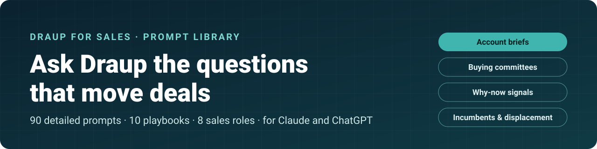
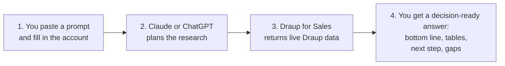

     

<b>Ready-to-use prompts for Claude, ChatGPT and Microsoft Copilot that turn Draup's sales intelligence into account briefs, buyer maps, target lists and outreach.</b>

<a href="https://draup.github.io/draup-sales-prompts/"><b>Open the interactive library &rarr;</b></a>

<a href="https://claude.ai/directory/draup-for-sales"><b>Add to Claude</b></a> · <a href="https://chatgpt.com/plugins/plugin_asdk_app_6ad0b735a0d88191b98c333a6fe40ce7"><b>Add to ChatGPT</b></a> · <a href="https://marketplace.microsoft.com/en-us/product/WA200010751"><b>Add to Teams &amp; Copilot</b></a> · <a href="guides/use-as-a-skill.md">Use as a skill</a> · <a href="guides/connect.md#option-3-any-mcp-client-custom-connector">Other MCP clients</a> · <a href="https://draup.github.io/draup-sales-prompts/">Interactive library</a> · <a href="#download-the-guides">PDF guides</a>

## Start in 3 steps

**1. Connect Draup to your AI.** About two minutes. You need a Draup account with Draup for Sales access.

| You use | Do this |
|---|---|
| **Claude** | [Add Draup for Sales from Claude's directory](https://claude.ai/directory/draup-for-sales), click **Connect** and sign in with your Draup account. |
| **ChatGPT** | [Add the Draup for Sales plugin](https://chatgpt.com/plugins/plugin_asdk_app_6ad0b735a0d88191b98c333a6fe40ce7) and sign in with your Draup account. |
| **Microsoft 365 Copilot or Teams** | [Get the Draup for Sales agent](https://marketplace.microsoft.com/en-us/product/WA200010751) from the Microsoft Marketplace (your admin may need to approve it). |
| **Claude Code, Cursor, VS Code or your own agent** | Add Draup as a custom MCP connector: [step-by-step setup](guides/connect.md#option-3-any-mcp-client-custom-connector). |

> **Want your AI to pick the prompt for you?** Add the whole library as a skill. [See below](#use-the-whole-library-as-a-skill).

**2. Tell your assistant about you, once.** Paste [Tell your AI about you](prompts/00-start-here/about-me.md) at the top of a new chat with your role, offering, territory and competitors. In Claude you can save it in a Project so it's always on.

**3. Pick a prompt, fill the `[brackets]`, paste.** Every prompt has a detailed version for the best results, a quick version, and follow-ups to keep going.

> Every answer opens with a two-line **bottom line** and closes with a **recommended next step** (who to contact, what to do, why now) and the **gaps** worth asking about in discovery.

<b>How it works</b>

## What you can do with it

| Job | What you get |
|---|---|
| **Walk into every meeting prepared** | A one-page brief on any account in two minutes: size, money, priorities and recent moves. |
| **Find the right people** | The buying committee, new leaders, and warm paths in through your existing customers. |
| **Reach out at the right moment** | Hiring spikes, new tools, news and leadership changes, with dates so you know how fresh each one is. |
| **Build better target lists** | Lists sized to your ICP, accounts using a competitor, companies hiring for what you sell. |
| **Win services deals** | The incumbent providers, how deep they go, and where the wedge is. |
| **Plan and grow accounts** | Account plans, risk checks, QBR prep and territory tiers backed by data. |

## Start here: pick your role

Each role page opens with the 5 prompts that role uses most, in order.

| Your role | Start with | Then try |
|---|---|---|
| [**Account Executive**](roles/account-executive.md) | [10-minute pre-call snapshot](prompts/01-account-research/precall-snapshot.md) | [One-page account brief](prompts/01-account-research/account-brief.md), [Map the buying committee](prompts/02-buyers-and-stakeholders/buying-committee.md) |
| [**SDR / BDR**](roles/sdr-bdr.md) | [Weekly trigger sweep for my book](prompts/04-signals-and-timing/weekly-book-sweep.md) | [What's worth acting on now](prompts/04-signals-and-timing/whats-actionable.md), [Signal-led emails for up to 10 accounts](prompts/04-signals-and-timing/signal-to-email.md) |
| [**Account & Customer Success Manager**](roles/account-manager.md) | [Renewal risk check (red, amber, green)](prompts/11-account-planning/risk-check.md) | [QBR prep: talking points and asks](prompts/11-account-planning/qbr-prep.md), [Best entry points: expand or new](prompts/11-account-planning/entry-points.md) |
| [**Sales Leader & RevOps**](roles/sales-leader-revops.md) | [One-page vertical market snapshot](prompts/14-industry-intelligence/vertical-snapshot.md) | [Tier my accounts by fit and timing](prompts/11-account-planning/propensity-tiering.md), [Carve balanced territories by geography](prompts/11-account-planning/territories.md) |
| [**Marketing & ABM**](roles/marketing-abm.md) | [ABM openers for 10 accounts at once](prompts/16-content-and-enablement/abm-messages.md) | [Build an industry point of view](prompts/14-industry-intelligence/industry-pov.md), [Size your ideal-customer list](prompts/06-prospecting-and-lists/icp-list.md) |
| [**Presales & Solutions**](roles/presales-solutions.md) | [One-page account brief](prompts/01-account-research/account-brief.md) | [What they run in one tech area](prompts/03-tech-stack-and-displacement/stack-category.md), [Who's already working each priority](prompts/03-tech-stack-and-displacement/priority-stack-incumbent-map.md) |
| [**Services, SI & Staffing Seller**](roles/services-seller.md) | [10-minute pre-call snapshot](prompts/01-account-research/precall-snapshot.md) | [Outsourcing footprint and consolidation wedge](prompts/10-outsourcing-and-services/outsourcing-footprint.md), [A rival's footprint and your wedge](prompts/10-outsourcing-and-services/competitor-at-account.md) |
| [**Partnerships & Alliances**](roles/partnerships-alliances.md) | [Which SIs to recruit in an industry](prompts/13-partners-and-alliances/recruit-si-shortlist.md) | [Accounts a partner can open for you](prompts/13-partners-and-alliances/sourced-pipeline.md), [Which providers to partner with or replace](prompts/10-outsourcing-and-services/partner-map.md) |

<b>The 12 most popular prompts</b>

| Prompt | What you get | Time |
|---|---|---|
| [10-minute pre-call snapshot](prompts/01-account-research/precall-snapshot.md) | Bottom line and who to contact first, then five lobby-length bullets: who they are, what just happened, where hiring in your function is moving, the priority closest to your offer, and one question to ask. | 1–2 min |
| [One-page account brief](prompts/01-account-research/account-brief.md) | Bottom line and a named person to call with a dated why-now, the person you're meeting (or the 3 closest if Draup lacks them), then the priorities in your function, who likely owns them, any competitor in the stack rated Red/Amber/Green and the key numbers. | 2–4 min |
| [Map the buying committee](prompts/02-buyers-and-stakeholders/buying-committee.md) | Who to open with and which sponsor to reach later, by name, then a ranked phone-readable list of the people likely to buy, influence or block your deal in one function or workload. | 2–4 min |
| [What's worth acting on now](prompts/04-signals-and-timing/whats-actionable.md) | An Act, Watch or Skip verdict and up to 5 real triggers from the last 90 days, kept or dropped with what you sell in mind (incidents and regulatory inquiries count if they bear on your offer), each with a named owner and a source count. | 2–4 min |
| [Signal-led emails for up to 10 accounts](prompts/04-signals-and-timing/signal-to-email.md) | For one account or up to 10 per pass: the most relevant recent signal (preferring your territory), the priority it supports, a fact check, and a short opener written in your persona's language that ends in one easy ask. | 4–6 min |
| [Size your ideal-customer list](prompts/06-prospecting-and-lists/icp-list.md) | The true count of companies matching every filter, distributors set aside, and the 5 accounts to start with, each with who to call and a dated why-now. | 4–6 min |
| [Renewal risk check (red, amber, green)](prompts/11-account-planning/risk-check.md) | A Red/Amber/Green risk table for one customer — your named sponsor, senior exits, layoffs, growth, installed and new competitor products in your workloads, negative news — with an overall rating and two actions. | 2–4 min |
| [QBR prep: talking points and asks](prompts/11-account-planning/qbr-prep.md) | Three talking points and three asks for your business review, built on what changed at the customer in your sponsor's function, set against the outcomes you delivered. | 4–6 min |
| [Tier my accounts by fit and timing](prompts/11-account-planning/propensity-tiering.md) | Up to 25 accounts scored 0–100 on fit to what you sell (hiring in your workloads, installed competitors) and timing (news, hiring, growth), tiered A, B or C with a spread you can act on, and the driver behind each score. | 4–6 min |
| [One-page vertical market snapshot](prompts/14-industry-intelligence/vertical-snapshot.md) | A one-page view of an industry scoped to your region: global size and growth beside a regional size from the top 10 buyers, the priorities that fit what you sell with dated company proof, the top buyers, and who to call first. | 4–6 min |
| [Outsourcing footprint and consolidation wedge](prompts/10-outsourcing-and-services/outsourcing-footprint.md) | How much the account outsources, to whom, how concentrated it is, and the workloads where a consolidation pitch for what you sell fits, ending with a named buyer and a dated why-now. | 2–4 min |
| [ABM openers for 10 accounts at once](prompts/16-content-and-enablement/abm-messages.md) | A table of short openers for up to 10 accounts per pass, each written to your persona in their language and tied to one stated priority and one dated signal from the last 60 days, graded Strong, OK or Weak, with sources and an optional joint partner note. | 6–10 min |

## Find prompts by sales job

| Sales job | What it covers | Prompts |
|---|---|---|
| [**Start here**](prompts/00-start-here/README.md) | Tell your AI who you are and what you sell, once. Every other prompt gets sharper. | 2 |
| [**Account research**](prompts/01-account-research/README.md) | Know the account before you call: size, money, priorities, filings and earnings calls. | 12 |
| [**Buyers and stakeholders**](prompts/02-buyers-and-stakeholders/README.md) | Find the people who own the problem and the budget, and a warm way in. | 7 |
| [**Tech stack and displacement**](prompts/03-tech-stack-and-displacement/README.md) | See what they run, what's new, what's fading, and where a competitor is installed. | 7 |
| [**Signals and timing**](prompts/04-signals-and-timing/README.md) | Reach out when something just changed: hiring spikes, leadership moves, news, new tools. | 11 |
| [**Outreach and messaging**](prompts/05-outreach-and-messaging/README.md) | Research-backed emails, call scripts, LinkedIn notes and briefing notes, each grounded in dated Draup facts. | 13 |
| [**Prospecting and target lists**](prompts/06-prospecting-and-lists/README.md) | Build, size and qualify target lists from firmographics, tech, hiring and growth. | 10 |
| [**Solution plays: by what you sell**](prompts/07-solution-plays/README.md) | Find the accounts most ready for what you sell, and check any account's readiness: cloud, data & AI, ERP, security, GenAI, CX, supply chain, HR tech, managed services, engineering, testing. | 22 |
| [**Deal strategy and qualification**](prompts/08-deal-strategy/README.md) | Win live opportunities: re-engage stalled deals, answer RFPs, build business cases, handle objections and beat a named competitor. | 10 |
| [**Competitive intelligence**](prompts/09-competitive-intelligence/README.md) | Track what rivals are winning, building and losing, and where you can take share. | 8 |
| [**Outsourcing and services deals**](prompts/10-outsourcing-and-services/README.md) | For IT services, consulting and staffing sellers: incumbents, share of wallet, GCCs and wedges. | 11 |
| [**Account planning and expansion**](prompts/11-account-planning/README.md) | Account plans, entry points, risk checks, QBR prep and territory tiering. | 11 |
| [**Expansion and cross-sell**](prompts/12-expansion-and-cross-sell/README.md) | Grow existing customers: global account maps, whitespace, cross-sell, new budget holders and sponsor coverage. | 8 |
| [**Partners and alliances**](prompts/13-partners-and-alliances/README.md) | Pick, plan and grow co-sell motions with the partners already embedded in your accounts. | 7 |
| [**Industry and market intelligence**](prompts/14-industry-intelligence/README.md) | Industry-level numbers, priorities and vendor landscapes for pitches and planning. | 7 |
| [**Sales leadership and RevOps**](prompts/15-sales-leadership-and-revops/README.md) | Size territories, segment books, plan pipeline and enable reps on new verticals. | 8 |
| [**Content and enablement**](prompts/16-content-and-enablement/README.md) | Turn Draup data into battlecards, ABM messages and email sequences. | 5 |
| [**Talent cost and location**](prompts/17-talent-cost-and-location/README.md) | Cost-arbitrage, location and hiring-difficulty cases for services pursuits. Uses the Draup for Talent connector. | 7 |

## Playbooks: complete workflows

Each playbook chains prompts into one end-to-end job. Run the steps in one chat.

| Playbook | Goal | Time |
|---|---|---|
| [**Be ready for a first meeting**](playbooks/playbook-first-meeting.md) | Walk into a first meeting knowing the account, the people in the room and the questions that will earn a second meeting. | About 12 min with quick versions, 25–35 min with detailed |
| [**Take accounts from a rival services firm**](playbooks/playbook-displacement-campaign.md) | Find accounts where a rival services firm is the incumbent, pick the ones where it's weakest, and open with peer proof and a timely, evidence-based message. | About 15 min with quick versions, 45–60 min with detailed |
| [**Monday routine: who to contact this week**](playbooks/playbook-weekly-signals.md) | Spend about half an hour each Monday finding which accounts and industry moves deserve action this week, and send the first touches. | About 15 min each week with quick versions, 30–40 min with detailed |
| [**Account manager: risk, QBR, expansion**](playbooks/playbook-protect-grow-customer.md) | For an existing customer, see what changed, rate the renewal risk, rebuild any lost relationships, walk into the QBR with a point of view, and leave with a named expansion play. | About 15 min with quick versions, 45–60 min with detailed |
| [**Outsourcing pursuit at a captive-centre account**](playbooks/playbook-gcc-services-pursuit.md) | Size an account's outsourcing and captive-centre (GCC) footprint, read its sourcing intent, check the main incumbent, and build a pursuit brief for the executive sponsor. | About 15 min with quick versions, 55–70 min with detailed |
| [**Co-sell an account with the right partner**](playbooks/playbook-partner-cosell.md) | Find where partners are already embedded at a target account, pick the right one to co-sell with, and open jointly. | About 12 min with quick versions, 35–45 min with detailed |
| [**Territory and list building: ICP to territories**](playbooks/playbook-territory-list.md) | Turn what your best customers have in common into a sized list, tier it on fit and timing for what you sell, carve it into balanced territories, and send the first touches to the top tier. | About 15 min with quick versions, 45–60 min with detailed |
| [**Break into a new industry**](playbooks/playbook-new-industry.md) | Learn a new industry fast, brief the team on its language and buyers, build a first account list, and launch outbound with a point of view. | About 15 min with quick versions, 45–60 min with detailed |
| [**Build a quarter's pipeline for one solution**](playbooks/playbook-solution-play.md) | Go from one solution area (for example cloud migration, data, ERP, security or HR tech) to a scored target list, qualified accounts with a named buyer, the incumbents to work around, and timed first touches that cite each account's own evidence. | About 20 min with quick versions, 60–75 min with detailed |
| [**A week of trigger-based outreach**](playbooks/playbook-trigger-outreach-week.md) | Turn one week of real account triggers into timely, multi-channel outreach: every message tied to a dated public fact, routed to the right person, with a call and voicemail behind each email and a clean re-open for stalled deals. | About 20 min of quick runs across the week, 60–90 min with detailed |
| [**Win a deal against a named rival**](playbooks/playbook-win-competitive-deal.md) | When a named rival is in your deal, size how entrenched it is, line up the people and the arguments, arm your champion, and close on a plan the buyer has agreed. | About 15 min with quick versions, 45–60 min with detailed |
| [**Revive a stalled deal or walk away**](playbooks/playbook-rescue-stalled-deal.md) | Decide whether a quiet deal is worth reviving, find a credible reason to re-engage, rebuild the case with the buyer's own numbers and set a realistic new close date. | About 15 min with quick versions, 40–50 min with detailed |
| [**Take accounts from a rival software vendor**](playbooks/playbook-competitive-takeout.md) | Pick a rival, understand where it's heading, find the accounts where its product is weakest, and open those accounts with a timely, evidence-based message. | About 20 min with quick versions, 60–90 min with detailed |
| [**Map a strategic customer, size the expansion**](playbooks/playbook-grow-strategic-account.md) | Map the whole customer, find the functions, units and sites you don't serve yet, secure the relationships that protect the account, and take a sized expansion case to your sponsor. | About 25 min with quick versions, 75–100 min with detailed |
| [**Sales leader plan: market to coverage**](playbooks/playbook-plan-next-quarter-territory.md) | As a sales leader, size the market for what you sell, pick where to add the next rep, tier the accounts, carve balanced territories, set coverage and next quarter's targets, then run the plan week to week. | About 25 min with quick versions, 70–90 min with detailed |
| [**Launch a co-sell programme with a partner**](playbooks/playbook-partner-program-launch.md) | Choose the right services partner for an industry, check it's heading the right way, build the joint pipeline, plan the first account together and arm the partner's sellers. | About 20 min with quick versions, 55–70 min with detailed |
| [**Run an ABM campaign for 10–20 accounts**](playbooks/playbook-abm-campaign.md) | Pick 10–20 target accounts, tier them, write each one a personalised opener from its own priorities and signals, multithread the top accounts, nurture the rest and refresh the list every week. | About 20 min with quick versions, 50–70 min with detailed |

## Use the whole library as a skill

Give your AI all the prompts at once. Then ask in plain words ("prep me for my call with Kroger") and it picks the right prompt, fills it in and follows it.

| You use | Do this |
|---|---|
| **Claude** | Download the [skill zip](dist/draup-sales-prompts-skill.zip), then in Claude go to *Customize → Skills → + → Upload a skill*. |
| **Claude Code** | `/plugin marketplace add Draup/draup-sales-prompts` then `/plugin install draup-sales@draup-sales-prompts` (also connects Draup). |
| **ChatGPT** | Create a Project or custom GPT, upload [the one-file library](dist/draup-sales-prompts-all.md), and paste the [ready-made instructions](guides/use-as-a-skill.md#chatgpt-project-or-custom-gpt). |
| **Any AI that can browse** | Paste: *"Use the Draup Sales Prompt Library at https://draup.github.io/draup-sales-prompts/llms.txt for my request."* |

Step-by-step for each option, plus Claude Projects and Microsoft Copilot: [Use the library as a skill](guides/use-as-a-skill.md).

## Download the guides

Printable PDFs for sharing and offline reading:

| Guide | What's inside |
|---|---|
| [**Quick-start guide**](pdf/draup-sales-prompts-quick-start.pdf) | How to connect, the start-here prompt, the 12 most useful quick prompts, and tips. |
| [**Full prompt catalogue**](pdf/draup-sales-prompts-catalogue.pdf) | Every prompt in full, with inputs, follow-ups and tips. |
| [**Playbooks**](pdf/draup-sales-prompts-playbooks.pdf) | Step-by-step workflows for common sales jobs. |
| [**Brief for your IT team**](pdf/draup-for-sales-connector-it-brief.pdf) | One page to share when IT blocks external connectors: what the connector can reach, the reviews it has passed and the controls admins keep. Also for [Draup for Talent](pdf/draup-for-talent-connector-it-brief.pdf). |
| **Role cheat sheets** | Each role's top 5, then all its quick prompts: [Account Executive](pdf/roles/account-executive.pdf) · [SDR / BDR](pdf/roles/sdr-bdr.pdf) · [Account & Customer Success Manager](pdf/roles/account-manager.pdf) · [Sales Leader & RevOps](pdf/roles/sales-leader-revops.pdf) · [Marketing & ABM](pdf/roles/marketing-abm.pdf) · [Presales & Solutions](pdf/roles/presales-solutions.pdf) · [Services, SI & Staffing Seller](pdf/roles/services-seller.pdf) · [Partnerships & Alliances](pdf/roles/partnerships-alliances.pdf) |
| [**Skill for Claude (zip)**](dist/draup-sales-prompts-skill.zip) · [**One-file library**](dist/draup-sales-prompts-all.md) | Use the whole library as a skill in Claude, ChatGPT or any AI. |

## How every prompt is built

Each prompt is written to get a decision-ready answer, not a data dump:

| Part | What it does |
|---|---|
| **Inputs** | The few things you fill in, each with an example. |
| **Steps** | Exactly which Draup data to pull, in what order, and how to narrow it. |
| **Output** | The tables and sections you get back, with columns, top N and units spelled out. |
| **Rules** | Guardrails that keep answers honest: every number is dated, and missing data says "Not in Draup" instead of a guess. |

159 of 166 prompts were tested live against Draup data on public companies and refined over three review rounds. The other 7 use the Draup for Talent connector and are marked *Preview*.

## The data behind the prompts

What Draup data the prompts use

| Draup data | What's in it |
|---|---|
| **Company & financials** | Profile, revenue, EBITDA, IT and R&D spend, forecasts, revenue by business unit and region, IT spend split, private funding. |
| **Earnings calls & filings** | Earnings-call and press-call transcripts with speakers, plus annual filings for US-listed companies. |
| **Priorities & opportunities** | Stated initiatives from earnings calls and news, by function and workload, with the tech and service providers attached; Draup-generated entry points. |
| **Executives & movement** | Key executives with level, budget control, workloads, past companies and LinkedIn; recent hires, promotions and exits. |
| **Tech stack** | Products in use with last-seen dates and usage strength, vendor landscape per workload, products adopted in the last 12 months. |
| **Hiring & job postings** | Posting volume and monthly trend, skills trending up or down, full job descriptions, market-wide 'who is hiring for X'. |
| **Talent flow & locations** | Hiring, attrition and net change by month, company and metro; key locations with HQ, GCC and new-site flags. |
| **News signals** | Account and market news by category: M&A, layoffs, funding, expansion, executive moves, partnerships, product launches. |
| **Outsourcing deals** | Customer-to-provider engagements: who outsources which workloads to whom, relationship tier, delivery locations. |
| **Industry ecosystem** | Industry revenue, IT and R&D spend, priorities, fast-growing tech, top vendors and outsourcers, growing and shrinking companies, startups, talent hubs. |
| **Company directory** | List building and market sizing by industry, HQ, size, technology, service providers and outsourced workloads. |
| **Talent cost & supply** | Base pay by role and city, talent pool size and growth, hiring difficulty, layoffs, employer brand (Draup for Talent connector). |

How to read each data type: [Data guide](guides/data-guide.md) · Terms explained: [Glossary](guides/glossary.md) · Connection details: [Draup's MCP documentation](https://draup.com/sales/data/model-context-protocol)

## Good to know

- **Your access applies.** Draup for Sales is read-only and shows what your Draup subscription covers.
- **Before you trust a number:**
  - Numbers: IT spend is a Draup estimate, often modelled from revenue, so use it for scale, not as a signal. Industry totals are global. Financials are in the company's reporting currency and fiscal year.
  - Freshness: news and hiring update continuously; leadership moves can lag by about three months, and brand-new executives may not appear yet.
  - People: some senior leaders have no function tag, so the prompts widen to C-level titles when needed. Draup can't search people by name.
  - Outsourcing engagements are Draup-derived records of work between a company and its providers, not published contracts.
  - Every drafted email ends with a "Check before sending" line listing any single-source or conflicting facts. Competitor tools are rated Red, Amber or Green by how entrenched they are.
  - Give the website the company actually uses (some parents use domains like home.barclays), and check names, titles and numbers before anything goes to a customer.
- **Keep customer data private.** Don't paste confidential CRM or customer data into prompts unless your company's AI policy allows it.
- **Tested in Claude.** The prompts were tested in Claude and written in plain language so they work with the ChatGPT plugin too.

## Help and contributing

- **Connection or access questions:** see [Connect Draup to your AI](guides/connect.md#troubleshooting) or email support@draup.com.
- **A prompt that could be better, or a new idea:** open an issue, or see [CONTRIBUTING.md](CONTRIBUTING.md) to submit a change.

## License

Prompts and guides: [Creative Commons Attribution 4.0](LICENSE). Code: [MIT](LICENSE-CODE). "Draup" is a trademark of Draup, Inc.; "Claude" is a trademark of Anthropic and "ChatGPT" of OpenAI. These licenses grant no trademark rights.

Free to use, share and adapt, including at work, as long as you credit *"Draup Sales Prompt Library by Draup, Inc."* and link back here. Data returned by Draup for Sales stays governed by your Draup agreement. Details: [NOTICE](NOTICE).

*Version 1.2.0 · updated 2026-11-27*
